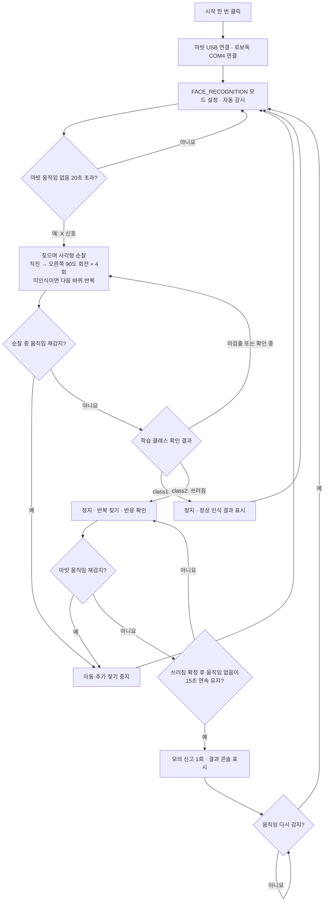

# 로보독 안부 확인 순서도

사전 학습: 마빗은 Working/NotWorking, 코코아팹 앱은 class1=정상 얼굴, class2=쓰러짐 사진으로 학습합니다. Python은 로보독에 저장된 학습 결과를 읽습니다.

- 순찰 중에도 마빗 수신과 학습 클래스 확인을 계속합니다.
- 클래스 확인은 신규 수신 패킷을 기준으로 하며, 잠깐의 미검출을 허용하고 오래된 결과는 만료합니다. 로보독 패킷의 신규 수신을 확인하는 것으로, 카메라 프레임 자체의 신규 촬영을 보장하는 것은 아닙니다.
- 정상 인식 후 같은 X 구간에서는 다시 출발하지 않고, 움직임 또는 무활동 시간 초기화 후 새로운 X 조건을 기다립니다.
- 마빗 또는 AI 연결이 끊기면 일시 정지하고, 연결이 돌아오면 자동 재개합니다. 거리 센서는 정지 조건에 사용하지 않습니다.
- 모의 신고만 기록하며 실제 전화·문자를 전송하지 않습니다.
- 쓰러짐이 확정된 뒤 모델 원본이 1 또는 0으로 바뀌어도 해당 사건의 쓰러짐 판정은 유지합니다. 마빗 움직임 재감지 시 경고를 취소하며, 다음 순찰에서 새 사건 판정을 시작합니다.
